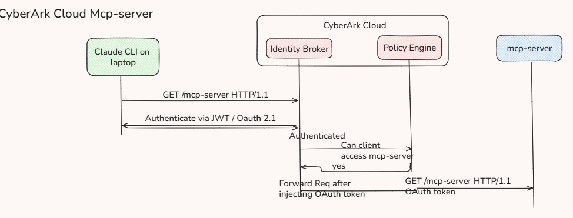

:toc:
:toclevels: 5


= CyberArk vs proto-mcp-pam

== AI Agent accessing Cloud MCP Server
=== CyberArk
- The AI agent sends its request to the CyberArk Identity Broker URL.
- CyberArk authenticates the agent (via OAuth 2.1 or JWT).
- CyberArk checks its policy inventory to see if that agent is allowed to access that specific target.
- If approved, CyberArk forwards the request to the upstream MCP server (often injecting an enterprise-managed credential or OAuth token on the agent's behalf).



== AI Agent accessing stdio (standard input/output)
- stdio is local communication transport.
- Desktop app(eg: claude code CLI) acts as the MCP client and spawns local Python Script(db_server.py) as child subprocess which will query local SQLite database or filesystem.

=== CyberArk (No Support for stdio)
- Identity Broker is built as a cloud-hosted SaaS proxy
- Because stdio relies on local operating system pipes rather than network sockets, CyberArk's cloud architecture is completely blind to it

=== proto-mcp-pam
- proto-mcp-pam is local binary that runs directly on your laptop or local development pod alongside your IDE or desktop client.
- proto-mcp-pam forks db_server.py to create an exact child process duplicate before executing the target binary.
- When configuring AI desktop client(eg: claude cli), proto-mcp-pam is launched using command line
```
{
  "mcpServers": {
    "secure-db-proxy": {
      "command": "proto-mcp-pam",
      "args": [
        "--policy",
        "/absolute/path/to/policy.yaml",
        "--",
        "python3",
        "/absolute/path/to/db_server.py"
      ]
    }
  }
}
```

```mermaid
sequenceDiagram
    autonumber
    participant Client as AI Client<br>(claude Cli)
    participant Proxy as proto-mcp-pam<br>(Go Binary)
    participant Subprocess as db_server.py<br>(Python)
    participant DB@{ "type": "database"} as DB
    
    Note over Client: Launch proto-mcp-pam<br>pass db_server.py as argument
    Client->>Proxy: proto-mcp-pam --policy policy.yaml -- python3 db_server.py
    Proxy->>Proxy: Parses CLI flags, parses policy.yaml<br>into memory AST
    Note over Proxy: spawn db_server.py
    Proxy->>Subprocess: fork() + execve("/usr/bin/python3", ["python3", "db_server.py"], [CleanEnv])
    
    
    Note over Client,Subprocess: Runtime JSON-RPC 2.0 Stdio Interception
    Client->>Proxy: JSON-RPC tools/call ("DROP TABLE users") via Stdin pipe
    Proxy->>Proxy: Unmarshals JSON-RPC frame<br>inspects params.arguments
    
    alt Policy Violation Detected
        Proxy->>Proxy: Matches rule:<br>block destructive DDL/DML keywords
        Proxy-->>Client: JSON-RPC Error Response: -32003 ("Blocked by proto-mcp-pam Policy Engine")
        Note over Proxy,Subprocess: Upstream db_server.py NEVER receives the request!

    else Policy Allowed (e.g., "SELECT from users..")
        Proxy->>Proxy: TokenProvider generates<br>JIT Ephemeral Credential (Ed25519 signed)
        Proxy->>Subprocess: Forwards JSON-RPC payload + Injected Token via child Stdin
        Subprocess->>Subprocess: Executes tool call against<br>database using short-lived<br>credential
        Subprocess->>DB: Select from Users ..
        DB->>Subprocess: Data
        Subprocess-->>Proxy: JSON-RPC Result Response via child Stdout pipe
        Proxy->>Proxy: Delete credential bytes from heap memory
        Proxy-->>Client: Forwards JSON-RPC Response to parent Stdout pipe
    end
```

